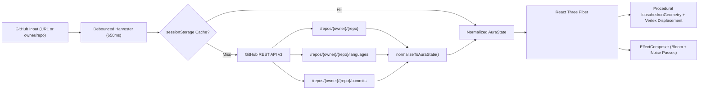

<div align="center">

# VOID MAPPER

### Generative 3D WebGL Telemetry Visualizer // Initiative: Vibecoder

[](https://react.dev/)
[](https://threejs.org/)
[](https://docs.pmnd.rs/react-three-fiber)
[](https://tailwindcss.com/)
[](https://vitejs.dev/)
[](./LICENSE)

**Void Mapper** is an aesthetic engineering and digital art web application that ingests any public GitHub repository URL or `owner/repo` identifier, harvests live telemetry via the GitHub REST API v3, and procedurally generates an interactive 3D WebGL artifact (**"The Aura"**) floating inside a stark, monochromatic digital museum (`#050505`).

</div>

---

## I. Executive Summary & Aesthetic Protocol

Traditional software dashboards reduce repositories to flat tables and charts. **Void Mapper** translates cold analytical telemetry—commit volume, language byte distribution, open issue turbulence, and repository age—into a living, breathing 3D spatial sculpture:

- **Minimalist Digital Museum**: True dark-mode (`#050505` / `#000000`) void environment with zero navbars, zero footers, and zero visual clutter.
- **Deterministic Procedural Art**: Every repository produces a repeatable, deterministic geometric and material signature rather than random noise.
- **Sensory Feedback**: A codebase with heavy technical debt or high open issue volume visibly reflects spiked vertex chaos, whereas a mature, tightly maintained library renders as a smooth, slowly rotating metallic monolith.

---

## II. Data-to-Aura Mapping Engine

The translation engine in [`src/services/githubHarvester.js`](./src/services/githubHarvester.js) deterministically maps GitHub REST API v3 payloads to Three.js geometry, material, physics, and post-processing properties:

| GitHub Data Metric | JSON Endpoint / Key | Three.js Property Impact |
| :--- | :--- | :--- |
| **Total Commits** | `/repos/{owner}/{repo}/commits` (`Link` header + count) | Dictates `IcosahedronGeometry` vertex density and subdivision detail (`D1`–`D14`). Logarithmically clamped so extreme outliers (`10,000+` commits) yield a smooth high-poly sphere without crashing the WebGL context. |
| **Top Languages** | `/repos/{owner}/{repo}/languages` (`Bytes`) | Determines base `MeshStandardMaterial` grayscale luminance (`#141414` to `#f5f5f5`), metallic sheen, and surface roughness—mapping language dominance to stark whites, brushed silvers, or deep obsidian grays. |
| **Open Issues** | `/repos/{owner}/{repo}` (`open_issues_count`) | Drives real-time normal-vector vertex displacement, multi-octave harmonic turbulence, and spiked glitch offsets (`chaosFactor`, `displacementAmplitude`, `spikeFrequency`). |
| **Repository Age** | `/repos/{owner}/{repo}` (`created_at` vs. `Now`) | Modulates rotational velocity (`rad/s`) and ambient scale pulse rate inside the `useFrame` render loop. Older repositories rotate slowly; brand-new repositories spin rapidly. |

---

## III. System Architecture



---

## IV. Core Technology Stack

- **Frontend Core**: [React 18](https://react.dev/) + [Vite 5](https://vitejs.dev/) for instant HMR while tuning 3D lighting and shader parameters.
- **3D WebGL Engine**: [Three.js](https://threejs.org/) + [React Three Fiber (`@react-three/fiber`)](https://docs.pmnd.rs/react-three-fiber) + [`@react-three/drei`](https://github.com/pmndrs/drei) (`OrbitControls`, `Float`).
- **Post-Processing Pipeline**: [`@react-three/postprocessing`](https://github.com/pmndrs/react-three-postprocessing) implementing `EffectComposer`, `Bloom` (luminance threshold + mipmap blur), and `Noise` passes.
- **Styling & HUD**: [Tailwind CSS](https://tailwindcss.com/) configured with a custom `void` monochromatic palette, hairline borders, `HYBRID` / `MONOLITH` / `WIREFRAME` shader toggles, and a `HUD [ON/OFF]` museum mode.
- **Rate-Limit Resilience**: Automatic `sessionStorage` caching per repository slug (`void_mapper_aura_v1:{owner}/{repo}`) plus deterministic procedural fallback if GitHub's 60 req/hr unauthenticated rate limit is exhausted.

---

## V. Project Structure

```text
VoidMapper/
├── index.html                        # Entry HTML with JetBrains Mono & Inter typography
├── package.json                      # Dependencies & scripts
├── vite.config.js                    # Vite bundler configuration
├── tailwind.config.js                # Strict dark/monochrome theme configuration
├── postcss.config.js                 # PostCSS + Tailwind pipeline
├── VoidMapper.pdf                    # Official Project Charter & Technical Blueprint
└── src/
    ├── main.jsx                      # React DOM root mount
    ├── index.css                     # Global void styles & radial vignette utilities
    ├── App.jsx                       # Debounced state controller & harvester integration
    ├── components/
    │   ├── AuraCanvas.jsx            # R3F <Canvas>, procedural vertex displacement & Bloom/Noise
    │   └── MinimalOverlay.jsx        # Floating command bar, presets & 4-axis telemetry matrix
    └── services/
        └── githubHarvester.js        # GitHub REST API v3 client, sessionStorage cache & Aura mapper
```

---

## VI. Getting Started

### Prerequisites
- **Node.js** `>= 18.0.0`
- **npm** `>= 9.0.0`

### Installation & Local Development

```bash
# 1. Clone the repository
git clone https://github.com/Pranshu125/VoidMapper.git
cd VoidMapper

# 2. Install dependencies
npm install

# 3. Start the Vite development server
npm run dev
```

### Production Build

```bash
npm run build
npm run preview
```

---

## VII. Interactive Controls

- **Repository Input (`GH://`)**: Paste any full GitHub URL (e.g., `https://github.com/mrdoob/three.js`) or `owner/repo` string (e.g., `Pranshu125/VoidMapper`, `facebook/react`, `torvalds/linux`).
- **Orbit & Inspect**: Left-click and drag to orbit the 3D Aura; scroll to zoom in/out (`2.8`–`9.5` units).
- **Material Modes**: Switch between **`HYBRID`** (solid metallic core + counter-rotating wireframe lattice), **`MONOLITH`** (pure grayscale/metallic `MeshStandardMaterial`), and **`WIREFRAME`** (luminous structural topology).
- **`HUD [ON/OFF]`**: Toggle all UI telemetry panels off for an uninterrupted 100% full-viewport digital museum exhibition.

---

## License

Released under the [MIT License](./LICENSE).  
**Architect**: [Pranshu125](https://github.com/Pranshu125) // **Initiative**: Void Mapper
